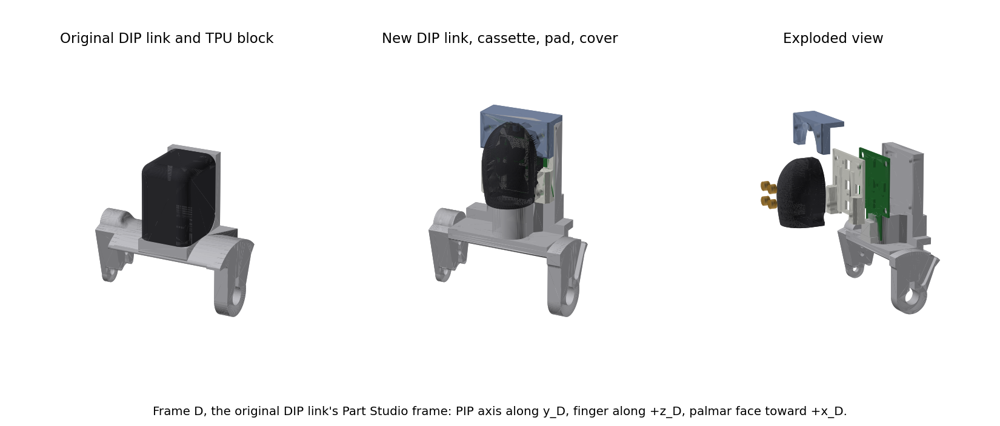

# Fingertip v4b with pad 05R4 as exact STEP for Onshape

`20261118-fingertip_v4b_05R4.step` has the ten parts of one fingertip of the SR2 hand as exact solids in one file. Every
part is in frame D, the frame of the original DIP link's Part Studio. In the owner's Onshape export of 2026-11-04
(`assets/cad_v3`), the three DIP links lie in this frame to within 0.032 mm. The new parts therefore cover the old DIP
link when their origin is fastened to its origin. The STEP file stays on the workstation and is not on GitHub, as all CAD
exchange files since 2026-11-06; `scripts/cad/fingertip_v4b_onshape_export.py` rebuilds it in under a minute.

## Parts in the file

| Part name in the file | Source | Material | Volume (mm³) | Faces |
|---|---|---|---|---|
| DIP link b v4 | [`../dip_link_v4b.step`](../dip_link_v4b.step) | PLA | 6404.5 | 481: planes and cylinders |
| Cassette 3T | [`../cassette_3T.step`](../cassette_3T.step) | PLA | 533.5 | 252 |
| Top cover TW15H3 trimmed | [`../top_cover_TW15H3.step`](../top_cover_TW15H3.step), trimmed | PLA | 508.0 | 278 |
| Pad 05R4 (TPU 85A) | rebuilt from its design | Siraya Tech 85A | 2945.9 | 50, six of them B-spline |
| Magnet N52 3x2 (four parts) | slot positions of 05R4 | N52, nickel | 14.1 each | 3 |
| ReSkin 5X board | the DIP design's board model | FR-4 with its parts | 327.2 | 74 |
| J1 header and Qwiic plug | the DIP design's board model | | 127.6 | 10 |

- The cover is trimmed like the caps on the hand: material palmar of x_F = -0.10 mm, 41.4 mm³, is removed
  (`ur5_cb3_cell.CAP_TRIM_X`; all tips were trimmed by 2026-10-27). The cover as printed is `../top_cover_TW15H3.step`.
- The pad is the 11/22 half-ellipsoid, 8.5 mm deep and 7.4 mm across, reaching 11 mm distal and 22 mm proximal of its apex,
  cut at the cassette's face. It has the dovetail grooves 0.05 mm inside the rails per flank, the screw-head notches
  (4.5 mm deep proximal, 1.5 mm distal) and the 1.6 mm pin hole, 3.0 mm deep with a 0.5 mm chamfer at its mouth. Its four
  magnet slots are closed voids inside the solid, as after the print's pauses. The engraved ID 05R4 is left out.
- Against the print file [`../fingertip_prints/pad_05R4_print.stl`](../fingertip_prints/pad_05R4_print.stl), the pad's
  surface lies within 0.025 mm everywhere except at the 0.4 mm deep engraving. Its volume is 2945.9 mm³; the print has
  2940.8 mm³ and 5.0 mm³ of engraving.
- Each magnet's name gives its pole toward the pad face, in 05R4's checkerboard: north at -y proximal and +y distal.
- The board's MLX90393 chips are 0.9 mm tall, the design's chip height, so their tops meet the pad's back face. The Qwiic
  cable past the plug is not drawn.
- The four M2 x 8 button-head screws (ISO 7380) are not in the file; Onshape's standard content has them. All four pass
  through the cassette and the board into the tongue, and the two distal ones also through the cover's ears.

In the assembled file the pad overlaps the cassette, the cover and the magnets; these are the press fits of the design.
The cassette's rails press 0.10 to 0.16 mm into the grooves' walls (5.9 mm³), and its side walls press on the pad's
flanks (5.0 mm³). The cover's side blocks press on the flanks at the tip end (9.4 mm³), and its 2.0 mm pin fills the
1.6 mm hole (2.6 mm³). Each magnet overlaps the pad by 0.22 mm³, the 0.05 mm squeeze per side of the 2.9 mm seat. No
other two parts overlap.

## Importing into Onshape

1. Import the STEP file into the hand's document (the + menu at the bottom left, Import). Leave the option that treats Y
   as the up axis off. Onshape makes an Assembly with the ten named parts in place, and a Part Studio with the parts.
2. Open the finger's assembly. In the export of 2026-11-04 the three fingers are instances of one sub-assembly, Finger v3,
   so one change updates all three. Insert the imported parts there.
3. Fasten the new DIP link's origin to the old DIP link's origin. Both origins are frame D, so the new link covers the old
   one. Fasten or group the other nine parts to the new link the same way.
4. Move the old link's mates to the new link. Its clevis arms are the original arms, fitted to the original within
   0.002 mm except for one 1 mm round on the horn arm's lower inner edge, which is sharp. The PIP bore and the horn slot are
   therefore the same faces. Then delete the old DIP link and the TPU block.

The record [`20261118-fingertip_v4b_05R4.json`](20261118-fingertip_v4b_05R4.json) lists each part's validity, faces,
volume and bounding box, the overlaps, the pad's distances to its print file, and each finger's transform from frame D to
the assembly frame A of the export of 2026-11-04.

## Frames

Frame D has the PIP axis along y_D through its origin, the finger along +z_D and the palmar face toward +x_D. The design
scripts work in frame F, with x_D = -x_F, y_D = y_F + 21.25 mm and z_D = -z_F - 51.55 mm. The DIP link is 9.75 mm longer
than the original, so its tip end lies at z_D = 46.91 mm against the original's 37.16 mm.

## Rebuild

    unset VIRTUAL_ENV; ~/miniconda3/envs/femtip/bin/python scripts/cad/fingertip_v4b_onshape_export.py params
    ~/.claude/bin/resguard.sh run --mem 3G --cpu 100 -- env -u VIRTUAL_ENV -u PYTHONPATH PATH=/usr/bin:/bin \
        OVF_CMD=step OVF_REPO=$PWD freecadcmd scripts/cad/fingertip_v4b_onshape_export.py
    ~/.claude/bin/resguard.sh run --mem 3G --cpu 100 -- env -u VIRTUAL_ENV ~/miniconda3/envs/femtip/bin/python \
        scripts/cad/fingertip_v4b_onshape_export.py check
    ~/.claude/bin/resguard.sh run --mem 3G --cpu 100 -- .venv/bin/python scripts/cad/fingertip_v4b_onshape_export.py render

The pad, board and magnet dimensions come from the design modules on the v4 parameters
(`docs/experiments/20261018-dip_link_board_mount/params/20261021-v4_concept_b.json`), so a change there reaches the STEP file
by rerunning these four commands.
