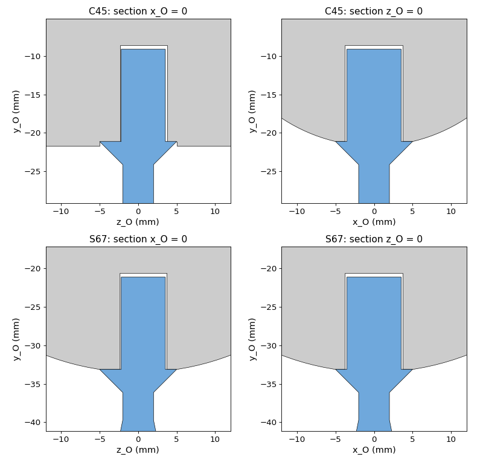

# Larger tracked objects and their stems with a glued spigot, 20261119

The 45 mm cylinder and the 67 mm sphere of `assets/tracking/20261117-large_objects/`, and the C45 and S67 stems of `assets/tracking/20261117-modular_blocks/`, with the stem glued into the object in place of the cotter joint (owner, 2026-11-19: "this cotter joint isnt going to cut it. this brass insert bottom seat will probably be fine though ... let's redesign the objects and top of stems to go back to the glued fastening. maybe we need a little more surface area / depth of contact to glue in these larger objects?"). The blocks are unchanged. Written by `scripts/hardware/tracking_objects_print.py glued build|figure|bambu`.

| Part | File | Print |
|---|---|---|
| cylinder body 45 mm (43.4 mm printed for the tape), no end tags, with the spigot's socket | `20261119-cylinder_white.stl` | standing on its -z end |
| sphere 67 mm, lower hemisphere with the spigot's socket | `20261119-sphere_lower_white.stl` | flat side down, the socket on top |
| sphere 67 mm, upper hemisphere | `20261119-sphere_upper_white.stl` | flat side down |
| dowel pin of the sphere (print three) | `20261119-sphere_pin_white.stl` | standing; print three |
| stem C45, square foot for the M2 insert to the seat and spigot, three dimples | `20261119-stem_C45_white.stl` | upright, foot on the bed, 5 mm brim |
| stem S67, square foot for the M2 insert to the seat and spigot, four dimples | `20261119-stem_S67_white.stl` | upright, foot on the bed, 5 mm brim |

Joint. The stem's top ends as on 2026-11-12, in a 45 deg cone and a flat seat 10 mm across that sits on a flat cut into the object. Above the seat a square spigot 5 mm across reaches 12 mm into the object, in place of the 4 mm key of 2026-11-12. The socket is 0.15 mm wider per side than the spigot, for the glue, and 0.5 mm deeper. The glue area is 305 mm2: 227 mm2 on the spigot's sides, 23 on its end and 55 on the seat. The key of 2026-11-12 had 138 mm2, 71 on the key and 66 on the seat. The spigot's depth also sets the lever that resists a side load: 12 mm against the key's 4 mm.

Key. One corner of the spigot is cut 2.2 mm from the axis, and the socket's corner is filled to match, so the stem goes in one way only. Turned by 90, 180 or 270 deg, the spigot meets the filled corner (16.9 mm3 overlap in the CAD). In the standing cylinder the socket's corners point up and down, so its upper faces print at 45 deg without support, and the filled corner is the socket's floor. In the sphere's lower hemisphere the socket is vertical. In the CAD the seated stem and the object share 0 mm3 on both objects.

Stems. The foot is the modular one of 2026-11-18: a square shank with an M2 heat-set insert, drawn into the block's socket by an M2 x 8 screw. The C45 stem is 56.0 mm long as printed and the S67 stem 40.7 mm; they are 2.03 and 1.79 g of solid PLA. Their codes and dimples are those of the modular blocks (C45 three, S67 four).

Assembly. Heat-set the insert into the stem's foot and screw the stem to its block (C45 on the block with ids 32-37, S67 on 38-43). Dry-fit the spigot in the object first: it goes in with the cut corner toward the socket's filled corner, and the seat then lies on the flat. Then glue it with epoxy or gel CA, which fill the 0.15 mm gap; wet the socket's walls and the seat, push the stem in until the seat is on the flat, and let it cure with the block hanging straight down. Glue the hemispheres with the three dowels.

Bambu Studio project `20261119-glued_objects_p1s.3mf`: the cylinder, both hemispheres and three dowels, 20 % lightning infill, in white on filament 1. Sliced again by the command line: 1.30 h, 42.8 g. Not in git; `tracking_objects_print.py glued bambu` rebuilds it.

Bambu Studio project `20261119-glued_stems_p1s.3mf`: the C45 and S67 stems, two each, with a 5 mm brim, in white on filament 1. Sliced again by the command line: 0.60 h, 6.4 g. Not in git; `tracking_objects_print.py glued bambu` rebuilds it.

The blocks print from `assets/tracking/20261117-modular_blocks/20261117-modular_blocks_p1s.3mf` (black on filament 1, white on filament 2).
