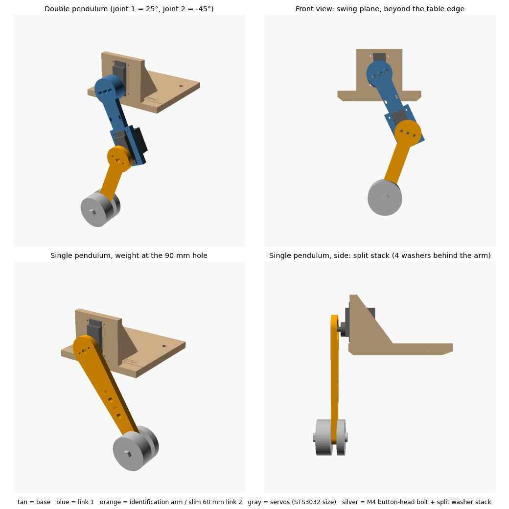
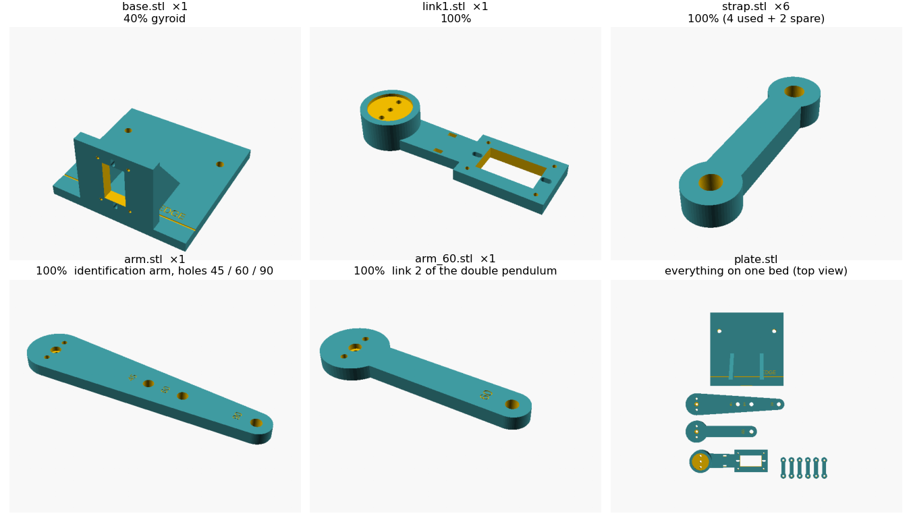

# BAM pendulum rig (SCS0009 and STS3032)

*2026-10-28.* A test rig for BAM (Better Actuator Models). It is one print set for both Feetech micro
servos. It works as a single pendulum (BAM identification) and as a double pendulum (validation,
like the paper's 2R arms). Source: [bam_pendulum.scad](bam_pendulum.scad) (OpenSCAD, parametric).



## Print set



| File | Qty | Walls | Top/bottom | Infill | Notes |
|---|---|---|---|---|---|
| `base.stl` | 1 | 4 | 5 | 40% gyroid | stiff mount; servo 1's torque reacts here |
| `link1.stl` | 1 | 4 | – | **100%** | double pendulum link 1 (L1 = 60 mm); front face on the bed, hub boss up |
| `arm.stl` | 1 | 4 | – | **100%** | identification arm, weight holes at 45 / 60 / 90 mm |
| `arm_60.stl` | 1 | 4 | – | **100%** | slim arm, link 2 of the double pendulum |
| `strap.stl` | 6 | 4 | – | 100% | tab clamps: 2 per servo, plus 2 spare |

**Settings for all parts** (PLA, 0.4 mm nozzle, Bambu Studio):
- 0.2 mm layers.
- Nozzle 220 °C, bed 55–60 °C on textured PEI.
- No supports, no brim, default speeds.
- **Import the STLs separately**, so each part gets its own infill. `plate.stl` is all of them merged into one object.
- **Elephant-foot compensation 0.15 mm.** The servo windows and the disc pockets open onto the bed, and a bulged first layer would make them tight.
- The arm pockets are on the bed face, so the slicer bridges about 18 mm over them at 1.4 mm. Default bridge settings are fine.
- **Why 100% on the arms and link 1:** uniform density makes the computed mass, center of mass and inertia below correct.
- **Weigh them after printing.** Expect 11.0 g for `arm.stl`, 6.1 g for `arm_60.stl` and 11.9 g for link 1. A few percent light is normal for "100%" prints; pass the weighed value to `bam_rig_params.py`.
- **Total:** roughly 70 g of PLA.

**Hardware:**
- 8 × M2 × 8 self-tapping screws (straps, into 1.7 mm pilot holes).
- 2 × M2 × 5 screws per disc horn:
  - machine screws for the aluminum disc (if its holes are threaded);
  - self-tapping screws for the white disc, with its 2 holes drilled to 1.5 mm.
- Center screws: each servo's stock thread, about 2 mm longer than stock.
- M4 **button-head** bolts (2.2 mm head) and nuts, one length per stack (see the weight plan).
  - Don't use socket-head bolts (4 mm heads): the room behind the arm is counted with a 2.2 mm head.
- Weights: steel washers, 30 mm across with an M4 hole, about 8 g per 1.5 mm washer. Up to 4 go behind the arm and the rest in front.
- A C-clamp.

## Why one identification arm
BAM fits **one** zero offset (`q_offset`: the angle between hanging plumb and the servo's reading) for
all of a servo's recordings. Each time an arm comes off, the disc horn can re-seat up to about ±1.9°
off (M2 screws in 2.4 mm holes, 6 mm from the center). That's about 0.03 rad, against fit errors of
0.003–0.01 rad in BAM's paper. So the arm goes on **once per servo**, and only the weight moves
between holes.

The arm runs past the weight to 96 mm, so it doesn't fit stock BAM's pendulum model (`bam/testbench.py`:
a point mass at the tip of a uniform rod that ends at the mass). Stock BAM would be up to 19% off in
gravity torque or inertia. Instead:
- each log records the arm's **real** first moment and inertia ([bam_rig_params.py](bam_rig_params.py));
- a small patch, going into the SCS0009 BAM package, makes BAM's `Pendulum` and its MuJoCo pendulum
  (`bam/testbench_mujoco.py`) use them.

The arm is heavier than slim per-length arms would be (11 g against 5–9.5 g). With the real values
logged, that costs little: even at the lightest setup (40 g at 45 mm), a 3% error in the arm's
properties is under 1% of the total.

The double pendulum's link 2 is the slim 60 mm arm (`arm_60.stl`). The long arm would reach about
156 mm below servo 1, past the clearance planned below the table edge.

```bash
python3 bam_rig_params.py --stack-g 80.3 --hole 60 --arm-g 10.8
python3 bam_rig_params.py --stack-g 40.2 --arm slim60      # link 2
```

The script prints:
- the values to log: first moment, inertia, and the washers' own spin inertia;
- an equivalent (mass, arm_mass) pair for stock BAM fitting. For this arm the pair has a negative arm mass, which BAM's MuJoCo pendulum can't take, so use it only for stock fitting.

## Computed mass properties (100% PLA, 1.24 g/cm³)

| Part | Mass | Center of mass from its axis | Inertia about its axis | Stiffness with 240 g at 90 mm |
|---|---|---|---|---|
| arm (identification) | 11.0 g | 37.3 mm | 247.1 g·cm² | at least the slim 90 mm arm's ~42 Hz first bending mode (this arm is wider everywhere) |
| arm_60 (link 2) | 6.1 g | 23.7 mm | 65.7 g·cm² | ~61 Hz |
| link 1 (without servo 2) | 11.9 g | 20.0 mm | 126.9 g·cm² | – |

## BAM compatibility check

| BAM requirement | This rig |
|---|---|
| Arm fixed directly to the output, no backlash | Disc horn in a pocket, 2 screws plus the center screw |
| Firm actuator mount | Window plus clamped tabs, base C-clamped to the table |
| Free swing: `up_and_down` to 90°, `sin_sin` to about ±119°, `lift_and_drop` free fall | No hard stops; the arm swings in open air in front of the wall, so a full turn is clear |
| Several loads and lengths | 3 holes (45 / 60 / 90 mm) × 3 weight stacks, at 9–49% of stall (BAM's paper: 6–49%) |
| Point load on a light, rigid rod | Washer stack on a rigid arm. The arm's real first moment and inertia are logged, so its shape doesn't matter (needs the patch) |
| Known mass, arm mass, length | Weighed on the kitchen scale; lengths fixed by the print |
| Arm zero = hanging plumb | Fitted by BAM as one `q_offset` per servo; the arm stays on for all of that servo's recordings |

**To handle when recording (software, not the print):**
1. **Center the horn.** Hanging straight down should be the servo's mid position: 512 counts on the SCS0009, 2048 on the STS3032. `sin_sin`'s ±119° then stays inside the SCS0009's 300° range.
2. **Drivers.** BAM already supports the STS3215, which uses the same STS protocol as the STS3032, so that part should mostly reuse. The SCS0009 needs a new BAM package (`actuator.py` on rustypot's SCS0009 controller, plus `record.py` and `all_record.py`).
3. **Logging rate.** BAM resamples to 5 ms, so raw logging should run at several hundred Hz. Set the FTDI latency back to 1 ms on the CB1 (it needs `sudo`).
4. **`lift_and_drop` must release the motor**, so it coasts rather than brakes. Check which of the driver's torque-off modes (`TORQUE_OFF` / `TORQUE_FREE`) does that on each servo.
5. **SCS0009 friction.** The arm only falls in `lift_and_drop` once gravity torque beats static friction, so use the heavier stacks there.
6. **Double pendulum = validation only.** BAM fits on the single pendulum. The double pendulum checks the fit: replay the commands in MuJoCo and compare against the logs, as the paper did with its 2R arms.

## Weight plan

**BAM's own setup** (Duclusaud et al., arXiv:2410.08650, Table I):
- Dynamixel MX-64 and MX-106: 0.5 / 1 / 1.5 kg × 0.10 / 0.15 / 0.20 m × 4 P gains × 4 trajectories.
- That's about 100 recordings of 6 s per servo, covering about 6–49% of stall torque.

**Ours, at the same fractions of stall** (arm included):

| | 45 mm hole | 60 mm hole | 90 mm hole |
|---|---|---|---|
| SCS0009: 40 / 80 / 120 g | 10 / 17 / 25% | 12 / 23 / 33% | 17 / 33 / 49% |
| STS3032: 80 / 160 / 240 g | 9 / 17 / 25% | 12 / 22 / 33% | 17 / 33 / 49% |

- Weigh each stack (bolt, washers and nut) on the kitchen scale.
- P gains: sweep the servo's default P gain and its 1/2, 1/4 and 1/6 fractions, as BAM's docs suggest.
- **Built-in check for bearing friction.** Two pairs give the same gravity torque with twice the weight on the bearings:
  - SCS0009: 80 g at 45 mm and 40 g at 90 mm;
  - STS3032: 160 g at 45 mm and 80 g at 90 mm.

  If the fitted friction or the free-fall decay differs within a pair, the bearing load matters.

**Split stacks: keep the weight close to the bearing.** Washer stacks are long: 240 g is about 29 washers, or 44 mm.
- **Why:** with every washer in front, the weight sits up to 34 mm in front of the servo's top face. That bends the output shaft and loads its bearings, adding friction that grows with the hanging weight. BAM's friction models don't include that kind of friction.
- **4 washers (6 mm) behind the arm,** between the bolt head and the arm. That's the most that fits:
  - `PART="clearance"` renders empty with 4, which is at least 2.5 mm from the wall, servo 1, link 1 and servo 2 over a full turn at every hole;
  - with 6 it collides.
- **The rest in front,** then the nut.

| Stack | Washers (rear / front) | Bolt | Weight's center in front of the servo's top face (all in front → split) | Added bearing friction (estimate) |
|---|---|---|---|---|
| 40 g | 5 (4 / 1) | M4 × 16–20 | 15 → 6 mm | ~0.2 mN·m |
| 80 g | 10 (4 / 6) | M4 × 25 | 19 → 11 mm | ~0.6 mN·m |
| 120 g | 15 (4 / 11) | M4 × 35 | 23 → 16 mm | ~1.1 mN·m |
| 160 g | 20 (4 / 16) | M4 × 40 | 27 → 20 mm | ~1.7 mN·m |
| 240 g | 29 (4 / 25) | M4 × 55 | 34 → 27 mm | ~3.4 mN·m |

- **Estimate assumptions:** plain bushings 10 mm apart and a friction coefficient of 0.15. The servos' bearing layout is unknown.
- **Worst case:** under 1% of the STS3032's stall torque. That's also small next to the ~60 mN·m of friction the hand's SCS0009s showed in earlier tests.
- **Direct measurement:** the check pairs above.

**Double pendulum** (link 2 = arm_60, weight at its 60 mm hole, split the same way):
- Fully stretched out horizontal, the empty chain needs about 0.014 N·m at servo 1.
- With an SCS0009 as servo 1, the 40 g and 80 g stacks reach about 27% and 48% of its stall. Servo 2 then sees at most about 22%.
- With an STS3032 as servo 1, use the 80 and 160 g stacks.
- Link 2's weight sits about 35–44 mm in front of servo 1's top face, so servo 1's bearings carry more bending load than during identification. That's acceptable for validation, but keep the SCS0009-as-servo-1 runs to the lighter stacks.

## Why one print fits both servos

| | SCS0009 | STS3032 | How the rig handles it |
|---|---|---|---|
| Body footprint | 23.2 × 12.1 mm | 23.2 × 12.1 mm | same window |
| Body height | 25.25 mm | 28.5 mm | the servo goes *through* the window and hangs on its tabs |
| Tab holes | 1 per tab (28.6 mm apart, from the AmazingHand CAD model) | 2 per tab plus a notch | tabs **clamped by printed straps**, so the hole pattern doesn't matter |
| Output spline | 20-tooth, 3.95 mm | 25-tooth, 4.95 mm | arms attach to the **stock disc horn** in a round pocket |
| Disc horn (measured) | white, 17.84 × 1.55 mm | aluminum, 18.0 × 2.0 mm | pocket 18.4 mm across, 1.4 mm deep |
| Disc screw holes (measured from photo) | small side pair, 12.0 mm apart | 8 holes on a 12.0 mm circle | one pair of 2.4 mm holes, 12.0 mm apart |
| Tab rear face to disc front face (measured) | 12.5 mm | 12.48 mm | same stack, so either servo can go in either joint |
| Stall torque (6 V) | 2.3 kgf·cm = 0.23 N·m | 4.5 kgf·cm = 0.44 N·m | separate weight stacks |

**Clearances** (STS3032 body size, worst case):
- **Servo 2 to the base wall:** servo 2's body stays at least 4.1 mm in front of the wall, and outside it radially, at any angle.
- **Disc horns to the tab straps:** at least 4.5 mm above the strap screw heads.
- **Rear half-stacks:** at least 2.5 mm from everything behind the arm, over a full turn (`PART="clearance"`).
- **Straps to the servo body:** the straps fit between the body end and the tab end with 0.25 mm to spare.

## Assembly
1. **Disc horn to arm** (before it goes on the servo; for identification, once per servo):
   - Disc in the pocket on the arm's back face, flat side first.
   - Turn it until 2 opposite holes line up with the arm's pair. On the aluminum disc any opposite pair works; on the white disc use the small hole on each side.
   - Fix with 2 M2 × 5 screws from the arm's front face. No longer than 5 mm, or they hit the servo's output boss.
2. **Servo 1:**
   - Into the base window from the front: shaft at the bottom, pointing away from the table, tabs on the wall's front face.
   - A strap across each tab, 2 self-tapping screws each.
3. **Base:**
   - Line up the **EDGE** groove with the table edge; the wall then overhangs it by 10 mm.
   - C-clamp the foot.
   - Keep about 150 mm below the edge clear (no apron or leg).
4. **Arm on servo:** press it onto the spline, hanging roughly straight down, and fit the center screw.
5. **Double pendulum:**
   - Link 1 goes on servo 1.
   - Servo 2 goes into link 1's window from the front, with its body toward servo 1's axis, and is strapped.
   - The slim 60 mm arm goes on servo 2.
   - Zip-tie servo 2's cable at link 1's slots, leaving a loop at the hub.
6. **Weights:**
   - Order on the bolt: head, up to 4 washers, arm, the remaining washers, nut.
   - Between holes, move only the weight and leave the arm on the servo.

## Safety (test scripts)
- **Joint limits:** keep each joint within ±125° of hanging (`sin_sin` needs ±119°). Also use the usual wall-clock torque-off backstop, temperature abort, and torque-off in `finally`.
- **Spare servos:** use spares with IDs that don't clash with the hand's (0–8), for example 20 and 21 (`host/examples/set_servo_id_scs0009.py`).
- **STS3032 protocol:** it uses Feetech's STS register map, so it needs rustypot's STS controller, not the SCS0009 one.

## Parametric source
These parts are in the `.scad` file but not in the print set:
- `PART="coupon"`: a fit test.
- `PART="assembly"`: view only.
- `PART="clearance"`: the rear half-stack swept a full turn against the base, link 1 and the servos. It must render empty.

```bash
openscad -D 'PART="arm"' -o arm.stl bam_pendulum.scad
openscad -D 'PART="slim_arm"' -D 'SLIM_L=60' -o arm_60.stl bam_pendulum.scad
openscad -D 'PART="clearance"' -o /tmp/c.stl bam_pendulum.scad    # expect "top level object is empty"
```
